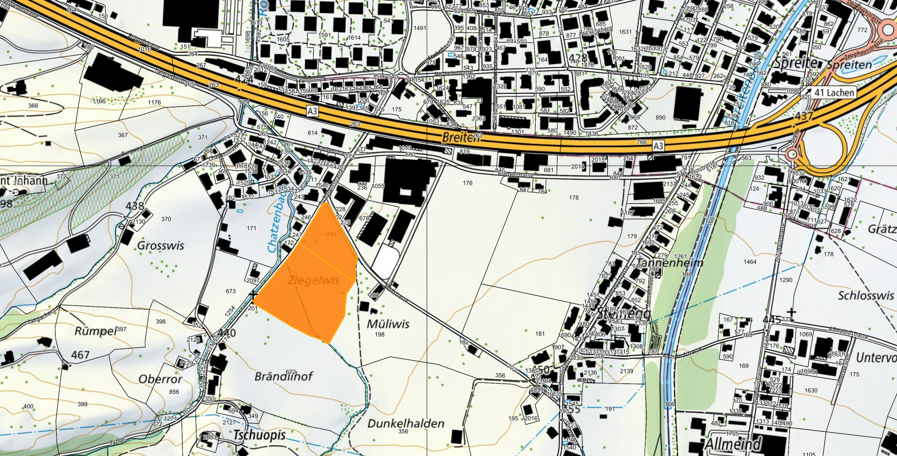

**Ein Nein klingt nach Sparen. Doch fehlender Schulraum verschwindet damit nicht. Das zeigt die Ziegelwis in Altendorf: Dort hätte 2019 eine neue Oberstufenschule eröffnen sollen. Stattdessen bewilligte die March später fast 48 Millionen Franken für den Kauf und Ausbau des alten Standorts in Lachen.**

## Warum der Bezirk neu bauen wollte

<a href="https://sek1march.ch/" target="_blank" rel="noopener">Die Sek 1 March</a> führt drei Standorte: Siebnen, Buttikon und Lachen. In Lachen besuchen Jugendliche aus Lachen und Altendorf die Oberstufe.

Schon vor über zehn Jahren war das <a href="https://maps.app.goo.gl/jrwJH24ukypTNKue8" target="_blank" rel="noopener">Schulhaus in Lachen</a> zu klein. Es gehörte nicht einmal dem Bezirk, er war dort nur Mieter bei der Gemeinde Lachen. Es fehlten zwei Klassenzimmer, fünf Gruppenräume, eine Schulküche und je ein Zimmer für textiles und nichttextiles Werken. Einige Schulzimmer entsprachen nicht den kantonalen Vorgaben. Weil auch die Turnhallen nur gemietet waren, fand der Sportunterricht teilweise über Mittag statt. Zudem lief der Mietvertrag für das Schulhaus im Juli 2019 aus (<a href="https://www.bezirk-march.ch/_docn/1098530/Bezirk_Voranschlag_2015.pdf" target="_blank" rel="noopener">Voranschlag 2015, Seite 35</a>).

Der <a href="https://www.bezirk-march.ch/" target="_blank" rel="noopener">Bezirksrat</a> wollte deshalb in der Ziegelwis neu bauen, auf Altendorfer Gemeindegebiet nahe Lachen. Das rund 22’000 Quadratmeter grosse Areal hätte er für 60 Jahre im Baurecht übernommen, für rund 274’000 Franken pro Jahr. Die Lage zeigt die <a href="https://map.geo.sz.ch/s/FECKEZ" target="_blank" rel="noopener">Karte des Kantons Schwyz</a>.

<figure class="article-figure">

<figcaption>Hier hätte ab 2019 die neue Oberstufenschule stehen sollen: die beiden Grundstücke in der Ziegelwis, Altendorf. Karte: <a href="https://map.geo.sz.ch/s/FECKEZ" target="_blank" rel="noopener">WebGIS Kanton Schwyz</a>, © swisstopo</figcaption>
</figure>

Lachen hatte dem Bezirk bereits damals angeboten, das bestehende Schulhaus für 11 Millionen Franken zu kaufen. Der Bezirksrat hielt einen Neubau jedoch langfristig für wirtschaftlicher als Kauf, Sanierung und Ausbau mit weiterhin gemieteten Turnhallen (<a href="https://www.bezirk-march.ch/_docn/1098530/Bezirk_Voranschlag_2015.pdf" target="_blank" rel="noopener">Voranschlag 2015, Seiten 35–39</a>).

## Das Nein und seine Folgen

Am 8. März 2015 lehnte die March die Vorlage für das Baurecht und einen Planungskredit von 750’000 Franken mit <a href="https://www.bezirk-march.ch/abstimmungsresultate/termine/1629305" target="_blank" rel="noopener">65,3 Prozent Nein</a> ab. Damit endete die Planung noch vor dem Architekturwettbewerb. Bekämpft wurde die Vorlage vor allem von der SVP March, die vor der Abstimmung ein eigenes Podium dazu organisierte (<a href="https://www.hoefe.ch/wp-content/uploads/2023/07/12.02.2015-baumschneiden.pdf" target="_blank" rel="noopener">March-Anzeiger vom 12. Februar 2015</a>). Ein Leserbrief sprach Jahre später von der «Frontalopposition» der SVP March (<a href="https://march24.ch/articles/69284-leserbriefe-zur-sek-i-march" target="_blank" rel="noopener">march24.ch, 2021</a>).

Auch einige von uns haben damals Nein gestimmt. Dafür gab es unterschiedliche Gründe, die wir respektieren. Uns geht es hier allein um die Kosten und darum, dass später bauen oft teurer wird. Auch in Wangen rechnen wir damit, wie wir bereits in unserem <a href="/dokumente/2026-11-04_Flyer_A4_Pro-Schulraum.pdf" target="_blank" rel="noopener">zweiten Flyer</a> aufgezeigt haben.

Der Schulraumbedarf blieb. Es folgte jene Lösung, die der Bezirksrat hatte vermeiden wollen:

- **2017:** Kauf des alten Schulhauses für 11 Millionen Franken sowie 2,2 Millionen für Fachräume und einen rollstuhlgängigen Zugang (<a href="https://www.bezirk-march.ch/_rte/abstimmung/162085" target="_blank" rel="noopener">Abstimmung vom 21. Mai 2017</a>).
- **Ab 2018:** Provisorium und schrittweiser Umbau am bestehenden Standort (<a href="https://www.bezirk-march.ch/_docn/2839390/Bezirk_March_Verwaltungsbericht_zur_Rechnung_2019.pdf" target="_blank" rel="noopener">Verwaltungsbericht 2019</a>).
- **2023:** Weitere 34,7 Millionen Franken für einen Erweiterungsbau, mit 66,1 Prozent Ja (<a href="https://www.new.sek1march.ch/standorte/lachen/schulanlage/erweiterung.html" target="_blank" rel="noopener">Sek 1 March, Erweiterung Lachen</a>).

Statt die neue Schule 2019 zu beziehen, musste der Bezirk die Raumfrage am alten Standort weiterlösen. Laut einem <a href="https://marchhoefe24.ch/articles/239584-die-sek-1-march-in-lachen-benoetigt-dringend-schulraum" target="_blank" rel="noopener">Bericht vom April 2024</a> braucht es spätestens auf das Schuljahr 2028/29 zusätzlichen Schulraum.

## Die Rechnung

| Geplant für die Ziegelwis | Mio. CHF |
|---|---:|
| Planung und Architekturwettbewerb | 0,75 |
| Neubau gemäss Finanzplan | 41,75 |
| **Total geplant** | **42,5** |

| Stattdessen am Standort Lachen bewilligt | Mio. CHF |
|---|---:|
| Kauf des alten Schulhauses | 11,0 |
| Fachräume und rollstuhlgängiger Zugang | 2,2 |
| Erweiterungsbau | 34,7 |
| **Total bewilligt** | **47,9** |

**Der Bezirk hat damit mehr bewilligt, als er damals für einen Neubau eingeplant hatte.** Hinzu kommen Ausgaben für Provisorien und weitere Sanierungen, soweit sie nicht in diesen Krediten enthalten sind.

Zur Einordnung: Die 42,5 Millionen für die Ziegelwis waren eine Finanzplanzahl (<a href="https://www.bezirk-march.ch/_docn/1098530/Bezirk_Voranschlag_2015.pdf" target="_blank" rel="noopener">Voranschlag 2015, Seite 29</a>), kein ausgearbeiteter Kostenvoranschlag. Die Beträge stammen zudem aus unterschiedlichen Jahren. Sie zeigen deshalb keine exakte Ersparnis eines Neubaus, wohl aber: Auch die Alternative nach dem Nein wurde teuer.

Auch die Turnhallen gehören zum Vergleich. Die Ziegelwis hätte eigene Hallen erhalten. In Lachen bleibt die Bezirksschule auf Hallen der Gemeinde angewiesen (<a href="https://marchhoefe24.ch/articles/239584-die-sek-1-march-in-lachen-benoetigt-dringend-schulraum" target="_blank" rel="noopener">marchhoefe24.ch, April 2024</a>). Deren neue Sport- und Kulturhalle kostet 57,6 Millionen Franken. Für die Übergangszeit war eine provisorische Doppelturnhalle für 5,25 Millionen vorgesehen (<a href="https://www.lachen.ch/public/upload/assets/2433/Pr%C3%A4sentation%20Info-Anlass.pdf?fp=1" target="_blank" rel="noopener">Gemeinde Lachen, Info-Anlass vom 24. September 2024</a>). Diese dienen auch anderen Nutzungen und lassen sich deshalb nicht vollständig der Bezirksschule zurechnen.

Ein Baurechtszins wäre an beiden Schulstandorten angefallen. Er ist in keiner der beiden Tabellen enthalten. Am See in Lachen ist der Boden aber teurer: Dort verlangte die Gemeinde 17 Franken pro Quadratmeter, in der Ziegelwis wären es 12.50 Franken gewesen (<a href="https://www.bezirk-march.ch/_docn/1098530/Bezirk_Voranschlag_2015.pdf" target="_blank" rel="noopener">Voranschlag 2015, Seiten 35 und 36</a>).

## Was Wangen daraus lernen kann

Ein Nein verschiebt den Entscheid, beseitigt aber den Bedarf nicht. Neue Planungen brauchen Zeit. Währenddessen kosten Provisorien, Mieten und Sanierungen weiter Geld. Und Bauen wird teurer: Die Baupreise im Hochbau sind seit Oktober 2020 um rund 16 Prozent gestiegen (<a href="https://dam-api.bfs.admin.ch/hub/api/dam/assets/36262128/master" target="_blank" rel="noopener">Bundesamt für Statistik, Baupreisindex Oktober 2025</a>). Wer wartet, bezahlt für das gleiche Schulhaus später mehr.

Auch in Wangen müssten die bestehenden Schulhäuser bei einem Nein saniert und Übergangslösungen finanziert werden. Gemäss unserer <a href="/argumente#nein-kostet-auch" target="_blank" rel="noopener">Zusammenstellung zur Nein-Variante</a> stehen dafür über 23 Millionen Franken im Raum, ohne zusätzlichen Schulraum. Darin enthalten sind der Verlust des zugesagten Kantonsbeitrags von rund 5,6 Millionen Franken und die bereits ausgegebenen Planungskosten von 740’000 Franken.

In Wangen liegt heute ein ausgearbeitetes Projekt mit <a href="/argumente#kostendach" target="_blank" rel="noopener">verbindlichem Kostendach</a> vor. Wir wissen, welche Räume entstehen und was sie kosten.

Die Ziegelwis zeigt: Ein Nein ist noch keine günstigere Lösung. Wangen kann am 29. November in eine langfristige Lösung investieren.

**Ja zur Schul- und Sportanlage Am Buechberg. Für unsere Kinder und Jugend. Für unsere Vereine. Für ganz Wangen.**
